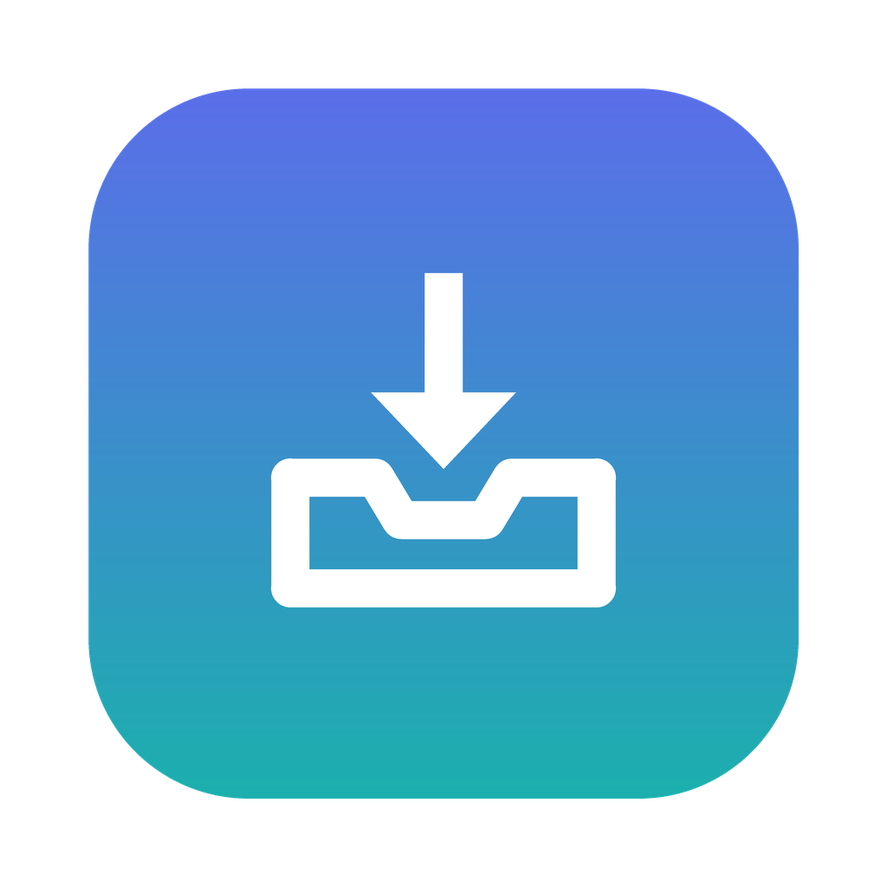

<p align="center"></p>

# SortDrop

SortDrop keeps your Downloads folder tidy. It sits in the menu bar (system tray on Windows), and every time a download finishes, it moves the file into the folder you chose for that type.

## Install

Download the latest version from the [Releases page](../../releases/latest). Python is built in, so there's nothing else to install.

**Mac** (Apple Silicon: M1 and newer): open `SortDrop-mac.dmg` and drag SortDrop into Applications. SortDrop isn't signed with an Apple developer certificate yet, so the first time you open it:
1. Open SortDrop. macOS will say it can't verify the developer. Click **Done**.
2. Go to **System Settings → Privacy & Security**, scroll down, and click **Open Anyway** next to SortDrop.
3. When SortDrop asks for access to your Downloads folder, click **Allow**.

**Windows**: run `SortDrop-windows.exe`. If SmartScreen warns you, click **More info → Run anyway**. Keep the .exe somewhere permanent, such as a `SortDrop` folder in Documents. "Open at login" starts it from wherever it is.

## How it works

- **First launch:** Settings opens. Choose a folder for each type (Documents, Images, Videos, Audio, Archives, Installers, Code), or keep that type in Downloads. Nothing moves until you click **Save and start**.
- **New downloads** move automatically once they've fully finished. Half-done `.crdownload` / `.part` / `.download` files are never touched.
- **Unknown types** (e.g. `.epub`): SortDrop asks **Move to Others** (`Downloads/Others`), **Choose folder…** (the picker has a New Folder button), or **Keep in Downloads**. "Always do this" saves your answer, so you're only asked once per type.
- **Your rules:** "Extension is .pdf" or "Name contains invoice", each with its own folder. Name rules beat extension rules, and both beat the default types.
- **Colours:** the 10 palettes from GoalWall (Route card, Neon, Aubergine, Mocha, Catppuccin, Nord, Tokyo Night, Dracula, Matcha, Swiss), picked in Settings. Light and dark follow your system.
- **Menu:** Pause sorting, Sort existing files now, Undo (shows the last move), Open watched folder, Settings, Quit.
- **Never overwrites:** if `report.pdf` already exists, the new one becomes `report (1).pdf`.
- Settings are saved in `~/.sortdrop/config.json`, and every move is logged to `~/.sortdrop/moves.log`.

## Run from source

```bash
python3 -m pip install -r requirements.txt
python3 test_sorter.py   # sorting engine
python3 test_app.py      # the real app, off-screen
python3 app.py
```

## Build

Pushing to `main` makes GitHub test and build both apps (see the Actions tab for downloads). Publishing a Release on GitHub (e.g. tag `v1.0.1`) builds both apps again and attaches them to it. To build locally: `pip install pyinstaller pillow && pyinstaller --noconfirm sortdrop.spec`.

| File | What it is |
|---|---|
| `sorter.py` | Sorting rules, moving files, config. No UI. |
| `app.py` | Menu-bar app, file watcher, Settings window, pop-ups. |
| `theme.py` | GoalWall's colour palettes and the window styles. |
| `login.py` | "Open at login" for macOS and Windows. |
| `sortdrop.spec` | Packaging recipe (PyInstaller). |
